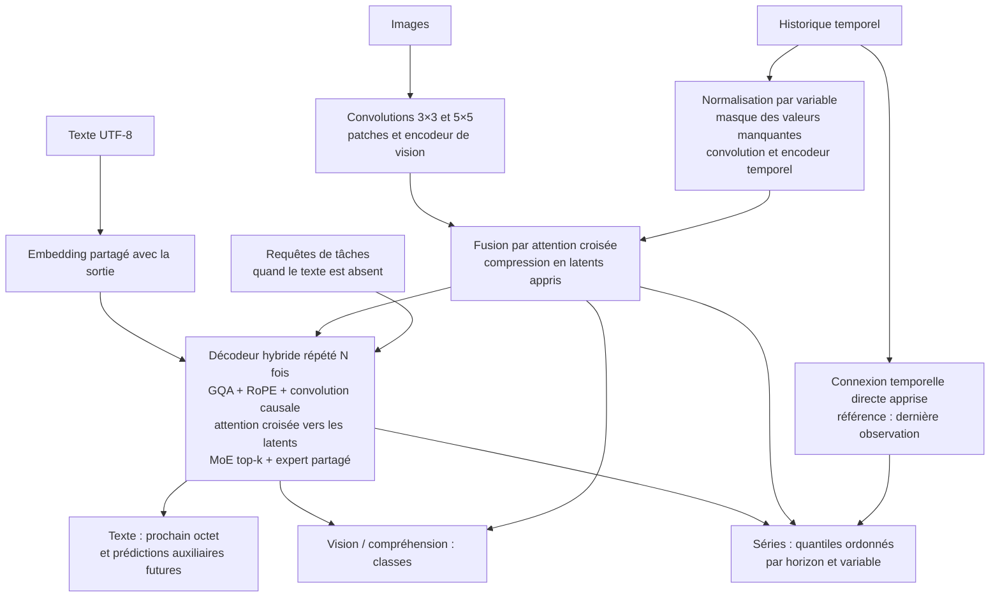

# CHIMERA

Un réseau PyTorch qui réunit les quatre usages demandés : modèle multimodal, génération de texte, vision et prévision de séries temporelles. Les trois modalités partagent un décodeur à mélange d'experts et peuvent être utilisées seules, par paires ou ensemble.

La complexité n'a pas de maximum absolu : on peut toujours ajouter des couches et des experts. CHIMERA fournit une architecture réellement entraînable, des configurations allant de **739 506 à 588 945 015 026 paramètres**, et un entraînement local de la configuration **549 485 298 paramètres**. Les grandes configurations sont décrites et comptées sans allocation des poids ; elles n'ont pas été entraînées ici.

Le checkpoint livré apprend sur des signaux synthétiques associés à des images de motifs et à de courtes descriptions. Il sert à démontrer l'apprentissage conjoint. Ce n'est pas un assistant préentraîné ni un modèle déjà performant sur des photos ou des textes quelconques. La complexité seule ne garantit pas la qualité.

Les checkpoints sous `runs/` sont disponibles dans l'espace de travail local et sont exclus de Git en raison de leur taille. Après un nouveau clone, les commandes d'entraînement ci-dessous permettent de les recréer ; les rapports de validation sont inclus dans le dépôt.

Les [améliorations mesurées](IMPROVEMENTS.md) décrivent le cache borné, le chargement des poids à la demande, le lecteur JSONL indexé et le suivi de validation.

Le [suivi de l'apprentissage](LEARNING.md) présente le fine-tuning du modèle existant, la comparaison des politiques de modalités et leurs compromis mesurés.

La [calibration des prévisions](CALIBRATION.md) ajuste les intervalles sur un jeu séparé et mesure leur couverture sur un test indépendant, avec des résultats pour les sept combinaisons de modalités.

Les [historiques courts et observations manquantes](ROBUSTNESS.md) couvrent l'augmentation temporelle, sa reprise reproductible et les comparaisons avec un entraînement témoin.

## Démarrage

Python 3.11 ou plus récent. Dans cet espace de travail, `.venv` contient déjà PyTorch CPU.

```bash
# Installation sur une autre machine, avec PyTorch CPU
python3 -m venv .venv
.venv/bin/python -m pip install torch --index-url https://download.pytorch.org/whl/cpu
.venv/bin/python -m pip install -e .

# Exécuter les trois entrées et les trois sorties
.venv/bin/python -m chimera demo

# Utiliser les poids entraînés localement
.venv/bin/python -m chimera demo --checkpoint runs/workstation/model.pt

# Poids affinés pour les historiques complets, conservés localement
.venv/bin/python -m chimera demo --checkpoint runs/workstation-robust-control/model.pt

# Vérifier l'architecture sans allouer ses poids
.venv/bin/python -m chimera inspect --all

# Vérifier le fonctionnement et les gradients
.venv/bin/python -m unittest discover -s tests -v
```

Sur GPU, installer une distribution de PyTorch adaptée à CUDA avant le projet, puis utiliser `--device cuda --amp bf16`. Le chemin GPU est fourni mais n'a pas été exécuté sur cette machine sans GPU utilisable.

## Architecture



Chaque bloc du décodeur combine :

- **Attention GQA** avec moins de têtes clé/valeur que de têtes requête, normalisation Q/K et positions rotatives RoPE.
- **Attention causale locale et globale** : fenêtre locale dans certains blocs, contexte global tous les `global_every` blocs.
- **Convolution causale à porte** en parallèle de l'attention, avec son propre état de génération.
- **Attention croisée multimodale** à porte vers les latents des images et de l'historique.
- **Experts SwiGLU** : routage top-k par token, experts partagés toujours actifs, aucune suppression de tokens, pénalités d'équilibrage et de stabilité du routeur.
- **RMSNorm**, connexions résiduelles et initialisation réduite des sorties d'experts.

Le modèle ajoute une prédiction auxiliaire de plusieurs tokens futurs, un alignement contrastif entre modalités, la normalisation temporelle réversible, une projection directe de l'historique vers les horizons futurs et une tête de prévision dont les quantiles ne peuvent pas se croiser. Le tokenizer par octets couvre tout Unicode sans téléchargement de vocabulaire ; il est moins compact qu'un tokenizer de sous-mots.

Les encodeurs d'images et d'historique sont bidirectionnels. L'historique donné en entrée doit donc se terminer **avant** le futur à prédire. Les futurs cibles ne sont jamais injectés dans les latents. Le décodeur de texte est causal, y compris sa convolution ; les tests modifient les tokens futurs et vérifient que les logits passés restent identiques.

## Tailles disponibles

Les comptes dédupliquent l'embedding et la tête de texte, qui partagent leurs poids.

| Configuration | Paramètres | Couches du décodeur | Experts par couche / sélectionnés | Poids BF16 seuls |
| --- | ---: | ---: | ---: | ---: |
| `tiny` | 739 506 | 3 | 4 / 2 | 0,001 Gio |
| `small` | 55 607 282 | 8 | 8 / 2 | 0,104 Gio |
| `workstation` | 549 485 298 | 12 | 16 / 2 | 1,023 Gio |
| `base` | 1 534 337 266 | 16 | 16 / 2 | 2,858 Gio |
| `large` | 39 285 370 354 | 32 | 32 / 2 | 73,175 Gio |
| `ultra` | 588 945 015 026 | 64 | 64 / 4 | 1 096,996 Gio |

Les experts partagés s'ajoutent aux experts routés : un pour tous les presets, deux pour `ultra`. Le nombre de paramètres sélectionnés par token n'est ni un compte de FLOPS ni une mesure du pic mémoire. Tous les poids restent en mémoire dans cette implémentation.

`inspect` indique aussi une estimation mémoire pour AdamW en FP32 : poids + gradients complets + deux moments, hors activations et allocations temporaires. Pour `workstation`, cette estimation est d'environ 8,19 Gio ; pour `ultra`, elle dépasse 8 775 Gio. Les paramètres restent FP32 pendant l'entraînement AMP : la colonne BF16 ne décrit pas la mémoire du trainer.

Les fichiers de [configuration](configs/) permettent de modifier dimensions, profondeur, experts, variables, classes, horizon et quantiles. Ils ne plafonnent pas artificiellement la taille. Inspecter un fichier personnalisé :

```bash
.venv/bin/python -m chimera inspect --config configs/workstation.json
```

## Entraînement conjoint

```bash
# Vérification rapide sur CPU
.venv/bin/python -m chimera train --preset tiny --steps 100 --output runs/tiny

# Exécution utilisée pour le modèle livré
.venv/bin/python -m chimera --threads 4 train \
  --preset workstation --steps 240 --batch-size 8 --warmup 20 \
  --lr 0.0002 --modality-dropout 0.3 \
  --output runs/workstation --log-every 20 --save-every 60

# Mesure avant/après sur 64 exemples synthétiques indépendants
.venv/bin/python tools/benchmark.py --checkpoint runs/workstation/latest.pt

# Produire un petit jeu JSONL multimodal reproductible
.venv/bin/python tools/make_dataset.py --preset tiny --output runs/data

# Entraîner sur ses propres données et valider sur un fichier distinct
.venv/bin/python -m chimera train --preset tiny --steps 100 \
  --data runs/data/train.jsonl --val-data runs/data/validation.jsonl \
  --eval-every 10 --patience 5 --min-delta 0.001 --output runs/custom

# Mesurer le meilleur modèle sur un fichier indépendant
.venv/bin/python -m chimera evaluate --checkpoint runs/custom/best.pt \
  --data runs/data/validation.jsonl --output runs/custom/quality.json

# Classer, prévoir et générer sur un fichier de nouvelles entrées
.venv/bin/python -m chimera predict --checkpoint runs/custom/best.pt \
  --data runs/data/validation.jsonl --max-new-tokens 24 \
  --output runs/custom/predictions.jsonl

# Exporter les poids seuls pour réduire la taille et la mémoire de chargement
.venv/bin/python -m chimera export --checkpoint runs/custom/best.pt \
  --output runs/custom/model.pt
```

La perte totale combine les pertes de texte, classification et prévision, la prédiction auxiliaire de tokens, l'alignement et la régularisation des experts. Les poids sont configurables. La projection temporelle directe part de la dernière observation disponible par variable et apprend une correction, avec un taux d'apprentissage dix fois supérieur au réseau principal. `--modality-dropout` omet des entrées pour apprendre aussi avec des modalités absentes. La perte totale des logs peut alors porter sur des ensembles de tâches différents d'une étape à l'autre ; comparer les mesures de validation à modalités fixes.

`--modality-policy balanced` parcourt une fois chaque combinaison disponible par cycle mélangé : sept combinaisons si les trois entrées sont présentes. Le choix reste reproductible après une reprise et réparti entre les rangs DDP. Les sous-ensembles sans cible supervisée sont exclus. Cette option remplace le tirage par `--modality-dropout` ; la politique par défaut reste `dropout`. `metrics.jsonl` compte les micro-lots par combinaison sur le rang 0. L'équilibrage change les compromis entre tâches : consulter les mesures avant de le choisir.

Dans une configuration JSON, `alignment_mode: "class"` fait des exemples de même classe des positifs supplémentaires pour l'alignement. Les classes ignorées (`-100`) restent appariées individuellement ; sans classes, l'objectif habituel est conservé. Choisir cette option lorsque les classes définissent les groupes sémantiques à rapprocher. `alignment_mode: "paired"` et `alignment_temperature: 0.1` conservent les réglages précédents.

Le trainer propose AdamW, échauffement et décroissance cosinus du taux d'apprentissage, accumulation des gradients, écrêtage, AMP BF16/FP16 et recalcul d'activations. Il écrit `config.json`, `metrics.jsonl`, `validation.jsonl`, `evaluation.json`, `latest.pt` et `best.pt`. Les logs contiennent l'utilisation de chaque expert et les mises à jour ignorées par GradScaler en cas d'overflow. Les sauvegardes sont remplacées atomiquement et incluent le modèle, AdamW, le scaler, les RNG, le planning et l'état de validation.

`--eval-every` règle la fréquence de validation, et `best.pt` conserve toujours la plus petite perte de validation observée. `--patience` active l'arrêt après un nombre de validations sans progrès significatif ; `--min-delta` définit ce progrès. L'arrêt anticipé nécessite `--val-data`. Sans fichier de validation, les mesures portent sur un lot synthétique fixe et l'arrêt anticipé reste désactivé par défaut. Les décisions d'arrêt sont partagées entre les processus DDP.

Les fichiers d'entraînement sont mélangés de façon reproductible à chaque époque ; `--no-shuffle` conserve leur ordre. `--workers 2` active deux processus de lecture. Une reprise d'un ancien checkpoint conserve son ancien ordre de lecture par défaut.

Reprise exacte sur un processus, en conservant les mêmes arguments de planning et de données :

```bash
.venv/bin/python -m chimera train --preset tiny --steps 100 \
  --stop-after 40 --output runs/resumable
.venv/bin/python -m chimera train --preset tiny --steps 100 \
  --resume runs/resumable/latest.pt --output runs/resumable
```

La suite de tests compare les poids d'une exécution continue et d'une reprise avec dropout, accumulation, mélange des données et arrêt anticipé : ils doivent être identiques bit à bit. Les empreintes SHA-256 des JSONL d'entraînement et de validation sont conservées dans les nouveaux checkpoints et vérifiées à la reprise. Les fichiers d'images externes référencés par `image_path` doivent également rester identiques ; leur contenu n'entre pas dans l'empreinte du JSONL.

Pour adapter des poids existants avec un nouvel optimiseur, un nouveau planning et de nouvelles données :

```bash
.venv/bin/python -m chimera train --init-from runs/custom/model.pt \
  --data adaptation/train.jsonl --val-data adaptation/validation.jsonl \
  --steps 100 --lr 0.0001 --output runs/adaptation
```

`--init-from` accepte un checkpoint complet ou un export d'inférence et utilise sa configuration. L'étape repart de zéro et la provenance est enregistrée. `--resume` conserve l'état d'un entraînement interrompu ; les deux options sont exclusives.

Entraînement distribué DDP :

```bash
# Deux processus CPU ; chemin vérifié localement
.venv/bin/torchrun --standalone --nproc-per-node=2 -m chimera --threads 1 train \
  --preset tiny --steps 3 --batch-size 2 --warmup 1 --accumulation 2 \
  --output runs/ddp-smoke --log-every 1

# Exemple de deux GPU avec PyTorch CUDA installé
.venv/bin/torchrun --standalone --nproc-per-node=2 -m chimera train \
  --preset small --device cuda --amp bf16 --steps 1000 --output runs/gpu
```

DDP réplique le modèle sur chaque processus ; il ne répartit pas les experts ni les poids entre cartes. La reprise distribuée restaure les poids et l'optimiseur mais ne garantit pas la reproduction bit à bit des RNG de chaque rang. Les configurations dépassant la mémoire d'un accélérateur nécessitent un système de partitionnement supplémentaire ; FSDP, parallélisme tensoriel et parallélisme d'experts ne sont pas implémentés ici. Les masques d'attention locale restent denses pendant le préremplissage et le traitement de plusieurs nouveaux tokens. Pendant la génération, les couches locales ne conservent que `sliding_window - 1` anciennes positions ; les couches globales gardent le contexte complet. Les clés/valeurs du contexte multimodal sont projetées une seule fois par couche.

## Données et API

Un fichier JSONL contient un objet par ligne. Les champs de modalités doivent être cohérents dans un même fichier ; chaque modalité est facultative, mais au moins une est requise. Pour entraîner, fournir du texte ou au moins une cible de classification/prévision.

Le lecteur indexe les positions des lignes et charge les exemples à la demande : il garde environ 16 octets d'index par exemple, au lieu de conserver tous les tableaux Python. Le fichier est parcouru une fois à l'ouverture pour valider les modalités et calculer son empreinte. Les erreurs de conversion indiquent le fichier et la ligne. La commande `predict` écrit les résultats progressivement et remplace son fichier de sortie uniquement après une exécution réussie.

| Champ | Contenu |
| --- | --- |
| `text` | Chaîne UTF-8 ; BOS/EOS et cibles de texte ajoutés automatiquement |
| `image` | Tableau flottant `[canaux, hauteur, largeur]`, déjà à `image_size` |
| `image_path` | Alternative : PNG/JPEG relatif au JSONL, converti et redimensionné ; nécessite `pip install '.[vision]'` |
| `series` | Historique `[temps, series_features]`, du plus ancien au plus récent |
| `class_label` | Classe entière de `0` à `num_classes - 1` ; `-100` pour ignorer |
| `future` | Cible `[forecast_horizon, series_features]`, strictement après l'historique |

Les textes longs sont tronqués à `max_seq_len` en conservant EOS. Les historiques trop longs sont refusés pour éviter une troncature silencieuse. `null` dans un tableau numérique est converti en valeur manquante par l'outil de génération/chargement ; les tenseurs d'historique acceptent NaN. Les cibles de prévision non finies sont ignorées dans la perte.

Utiliser directement les tenseurs :

```python
import torch
from chimera import ByteTokenizer, Chimera, ChimeraConfig

config = ChimeraConfig.preset("tiny")
model = Chimera(config)
tokenizer = ByteTokenizer()
tokens = torch.tensor([tokenizer.encode("Décris ce signal.")])

result = model(
    tokens,
    images=torch.rand(1, 3, 32, 32),
    series=torch.randn(1, 24, 3),
    labels=tokens,                         # décalage causal effectué par le modèle
    class_labels=torch.tensor([2]),
    forecast_targets=torch.randn(1, 12, 3),
)
result.loss.backward()
print(result.logits.shape)                  # [1, tokens, 260]
print(result.classification_logits.shape)   # [1, 6]
print(result.forecast.shape)                # [1, 12, 3, 3] : q10, q50, q90

model.eval()
with torch.inference_mode():
    vision = model(images=torch.rand(1, 3, 32, 32))
    temporal = model(series=torch.randn(1, 24, 3))
    # Le futur peut aussi être conditionné sur une image et/ou du texte.
```

La classe de vision correspond aux étiquettes du jeu d'entraînement ; le modèle ne produit pas de nouvelles images. Les intervalles de prévision sont des quantiles appris, pas des garanties de couverture statistique. `attention_mask` et `series_mask` sont binaires `[B, T]`. Les valeurs manquantes par variable sont représentées explicitement. Les positions de padding ne participent pas au routage ni aux pertes de texte.

`evaluate` rapporte les pertes supervisées pondérées par leurs cibles réellement observées, l'accuracy, la MAE et la RMSE du futur, la MAE par horizon, la couverture et la largeur des intervalles. Une tâche sans cible valide a des mesures de qualité `null`. La perte totale et les termes de routage/alignement restent des moyennes par exemple ; l'alignement contrastif dépend de la composition des lots.

Génération avec cache clé/valeur **et** état de convolution :

```bash
.venv/bin/python -m chimera generate --checkpoint runs/workstation/model.pt \
  --prompt "Signal de classe " --max-new-tokens 32 --temperature 0
```

`model.generate(...)` accepte aussi `images=` et `series=` ; le contexte est calculé une seule fois. Température, top-k, top-p et arrêt EOS sont disponibles. Les batches de génération de longueurs différentes utilisent du padding à gauche. Le cache est réservé à l'inférence et sa longueur reste limitée par `max_seq_len`.

`load_checkpoint` utilise le mappage mémoire et une initialisation sur `meta` pour charger les poids sans copie complète et sans initialisation aléatoire préalable. Les pages sont lues à la demande ; la première inférence utilise ensuite la mémoire des poids consultés. `mmap=False` permet de charger un ancien fichier PyTorch qui n'utilise pas le format ZIP.

## Fichiers utiles

- [Modèle et pertes](chimera/model.py), [briques du réseau](chimera/modules.py), [configuration](chimera/config.py).
- [Entraînement et sauvegardes](chimera/training.py), [données](chimera/data.py), [CLI](chimera/cli.py).
- [Tests](tests/test_chimera.py), [protocole de mesure](tools/benchmark.py), [comptages exacts](artifacts/architectures.json).
- [Rapport de validation](VALIDATION.md).
- [Améliorations et mesures de mémoire](IMPROVEMENTS.md), [profilage reproductible](tools/profile_runtime.py).
- [CI Python 3.11 et 3.14](.github/workflows/tests.yml) : tests, inspection des presets et vérification DDP à chaque push ou pull request.

## Références

Cette implémentation combine des idées existantes ; ce n'est pas une reproduction des modèles de ces articles.

- [GQA — Ainslie et al.](https://arxiv.org/abs/2305.13245) : groupes de têtes clé/valeur.
- [RoFormer — Su et al.](https://arxiv.org/abs/2104.09864) : positions rotatives.
- [Switch Transformers — Fedus et al.](https://arxiv.org/abs/2101.03961) : routage et équilibrage des experts.
- [ST-MoE — Zoph et al.](https://arxiv.org/abs/2202.08906) : stabilité du routage.
- [Perceiver IO — Jaegle et al.](https://arxiv.org/abs/2107.14795) : compression et interrogation d'espaces latents.
- [Attention SDPA de PyTorch](https://docs.pytorch.org/docs/stable/generated/torch.nn.functional.scaled_dot_product_attention) et [recalcul d'activations](https://docs.pytorch.org/docs/stable/checkpoint).
