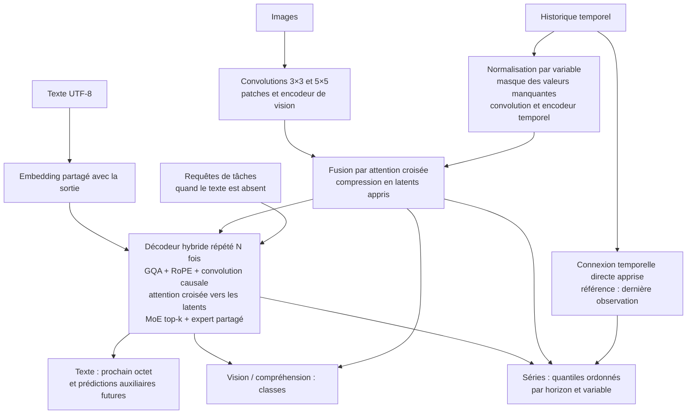

# CHIMERA

Un réseau PyTorch qui réunit les quatre usages demandés : modèle multimodal, génération de texte, vision et prévision de séries temporelles. Les trois modalités partagent un décodeur à mélange d'experts et peuvent être utilisées seules, par paires ou ensemble.

La complexité n'a pas de maximum absolu : on peut toujours ajouter des couches et des experts. CHIMERA fournit une architecture réellement entraînable, des configurations allant de **739 506 à 588 945 015 026 paramètres**, et un entraînement local de la configuration **549 485 298 paramètres**. Les grandes configurations sont décrites et comptées sans allocation des poids ; elles n'ont pas été entraînées ici.

Le checkpoint livré apprend sur des signaux synthétiques associés à des images de motifs et à de courtes descriptions. Il sert à démontrer l'apprentissage conjoint. Ce n'est pas un assistant préentraîné ni un modèle déjà performant sur des photos ou des textes quelconques. La complexité seule ne garantit pas la qualité.

Les checkpoints sous `runs/` sont disponibles dans l'espace de travail local et sont exclus de Git en raison de leur taille. Après un nouveau clone, les commandes d'entraînement ci-dessous permettent de les recréer ; les rapports de validation sont inclus dans le dépôt.

## Démarrage

Python 3.11 ou plus récent. Dans cet espace de travail, `.venv` contient déjà PyTorch CPU.

```bash
# Installation sur une autre machine, avec PyTorch CPU
python3 -m venv .venv
.venv/bin/python -m pip install torch --index-url https://download.pytorch.org/whl/cpu
.venv/bin/python -m pip install -e .

# Exécuter les trois entrées et les trois sorties
.venv/bin/python -m chimera demo

# Utiliser les poids entraînés localement
.venv/bin/python -m chimera demo --checkpoint runs/workstation/model.pt

# Vérifier l'architecture sans allouer ses poids
.venv/bin/python -m chimera inspect --all

# Vérifier le fonctionnement et les gradients
.venv/bin/python -m unittest discover -s tests -v
```

Sur GPU, installer une distribution de PyTorch adaptée à CUDA avant le projet, puis utiliser `--device cuda --amp bf16`. Le chemin GPU est fourni mais n'a pas été exécuté sur cette machine sans GPU utilisable.

## Architecture



Chaque bloc du décodeur combine :

- **Attention GQA** avec moins de têtes clé/valeur que de têtes requête, normalisation Q/K et positions rotatives RoPE.
- **Attention causale locale et globale** : fenêtre locale dans certains blocs, contexte global tous les `global_every` blocs.
- **Convolution causale à porte** en parallèle de l'attention, avec son propre état de génération.
- **Attention croisée multimodale** à porte vers les latents des images et de l'historique.
- **Experts SwiGLU** : routage top-k par token, experts partagés toujours actifs, aucune suppression de tokens, pénalités d'équilibrage et de stabilité du routeur.
- **RMSNorm**, connexions résiduelles et initialisation réduite des sorties d'experts.

Le modèle ajoute une prédiction auxiliaire de plusieurs tokens futurs, un alignement contrastif entre modalités, la normalisation temporelle réversible, une projection directe de l'historique vers les horizons futurs et une tête de prévision dont les quantiles ne peuvent pas se croiser. Le tokenizer par octets couvre tout Unicode sans téléchargement de vocabulaire ; il est moins compact qu'un tokenizer de sous-mots.

Les encodeurs d'images et d'historique sont bidirectionnels. L'historique donné en entrée doit donc se terminer **avant** le futur à prédire. Les futurs cibles ne sont jamais injectés dans les latents. Le décodeur de texte est causal, y compris sa convolution ; les tests modifient les tokens futurs et vérifient que les logits passés restent identiques.

## Tailles disponibles

Les comptes dédupliquent l'embedding et la tête de texte, qui partagent leurs poids.

| Configuration | Paramètres | Couches du décodeur | Experts par couche / sélectionnés | Poids BF16 seuls |
| --- | ---: | ---: | ---: | ---: |
| `tiny` | 739 506 | 3 | 4 / 2 | 0,001 Gio |
| `small` | 55 607 282 | 8 | 8 / 2 | 0,104 Gio |
| `workstation` | 549 485 298 | 12 | 16 / 2 | 1,023 Gio |
| `base` | 1 534 337 266 | 16 | 16 / 2 | 2,858 Gio |
| `large` | 39 285 370 354 | 32 | 32 / 2 | 73,175 Gio |
| `ultra` | 588 945 015 026 | 64 | 64 / 4 | 1 096,996 Gio |

Les experts partagés s'ajoutent aux experts routés : un pour tous les presets, deux pour `ultra`. Le nombre de paramètres sélectionnés par token n'est ni un compte de FLOPS ni une mesure du pic mémoire. Tous les poids restent en mémoire dans cette implémentation.

`inspect` indique aussi une estimation mémoire pour AdamW en FP32 : poids + gradients complets + deux moments, hors activations et allocations temporaires. Pour `workstation`, cette estimation est d'environ 8,19 Gio ; pour `ultra`, elle dépasse 8 775 Gio. Les paramètres restent FP32 pendant l'entraînement AMP : la colonne BF16 ne décrit pas la mémoire du trainer.

Les fichiers de [configuration](configs/) permettent de modifier dimensions, profondeur, experts, variables, classes, horizon et quantiles. Ils ne plafonnent pas artificiellement la taille. Inspecter un fichier personnalisé :

```bash
.venv/bin/python -m chimera inspect --config configs/workstation.json
```
